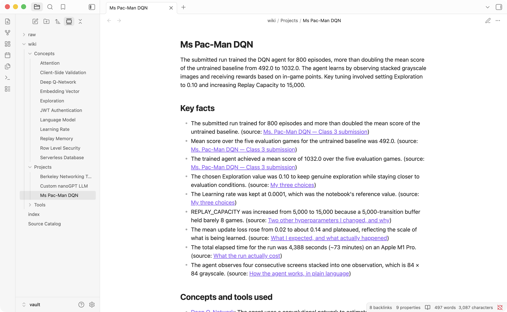
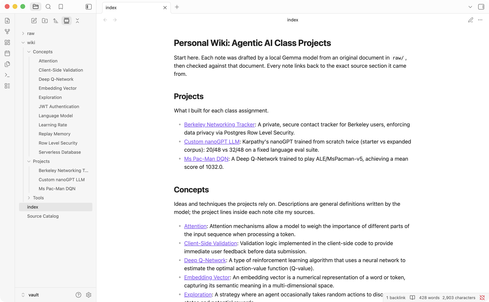
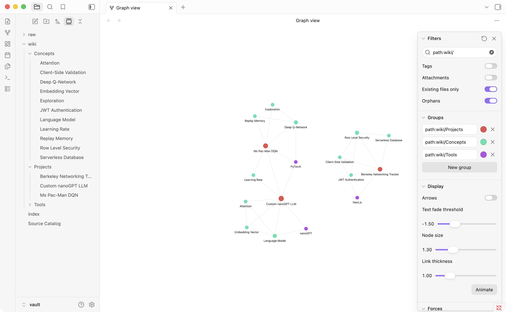
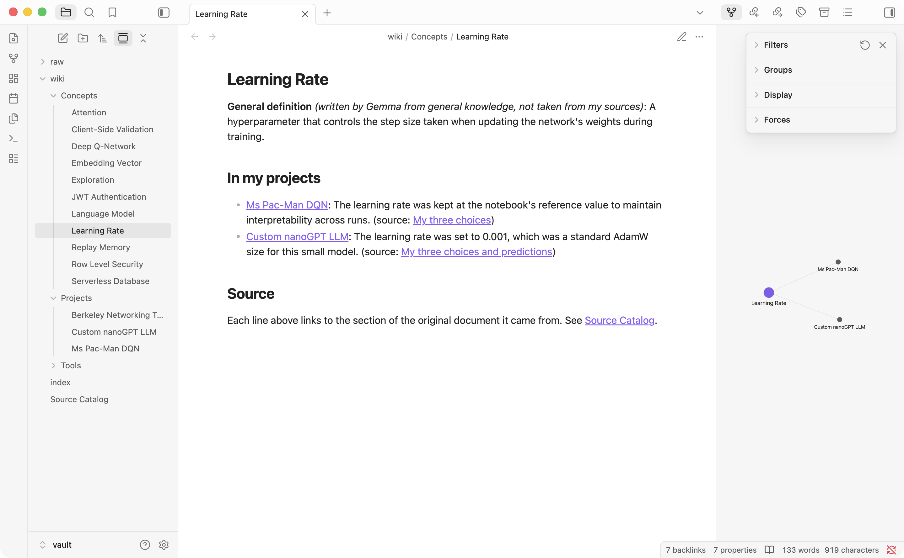
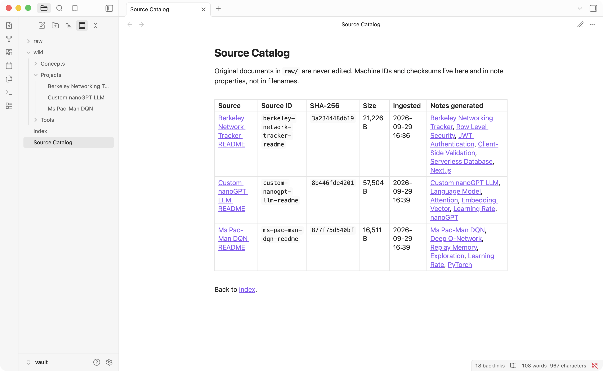
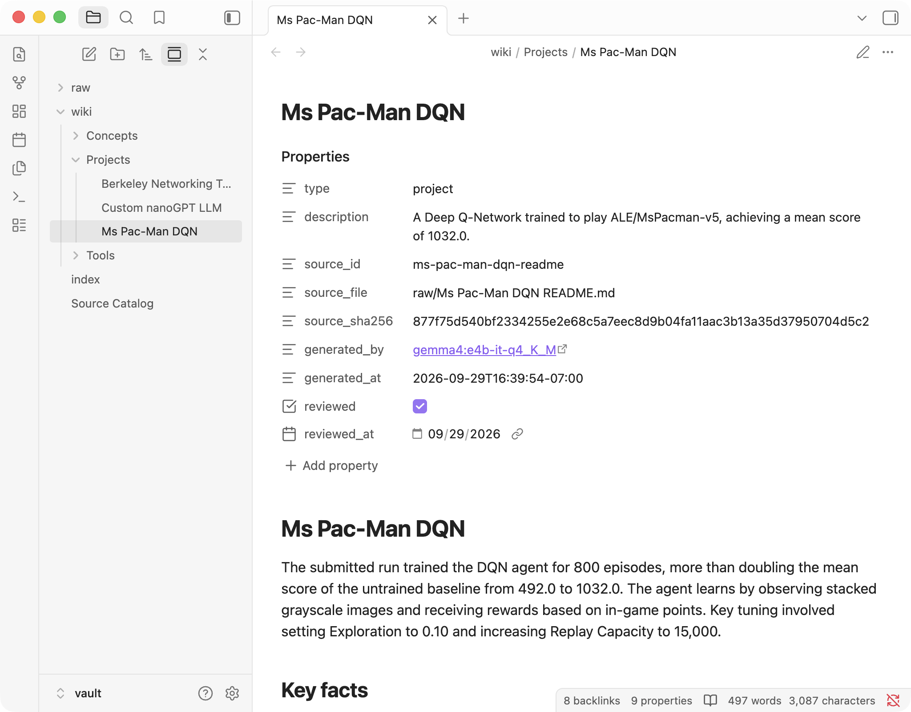
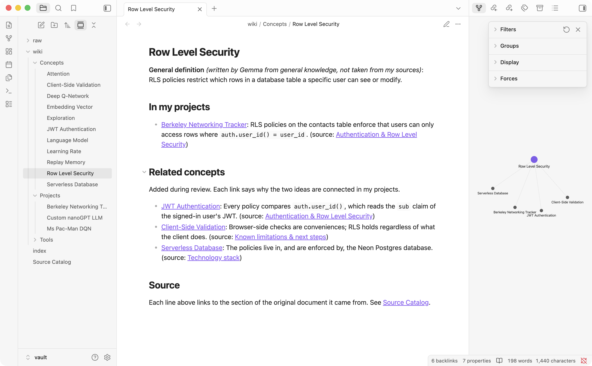

# Personal Wiki CLI: local Gemma over my own class-project notes

Assignment 4 (Class 5). A command-line harness I wrote that turns my own project write-ups
into an Obsidian wiki and answers questions about them with a **local Gemma 4 model and no
internet**. It has three modes: `chat` (personal assistant), `ask` (cited factual answers) and
`search` (raw passages), plus `ingest` and `--help`.

**Evidence at a glance**

| What | Result | Link |
|---|---|---|
| 4 ask-mode tests, offline | 3 grounded, cited answers + 1 correct INSUFFICIENT EVIDENCE, with Wi-Fi off and again with the final code | [final-code cards](evidence/offline/sandbox-final-code-20260929-202152/ask/) · [Wi-Fi-off cards](evidence/offline/wifi-off-20260929-194803/ask/) |
| Chat / search mode checks, offline | 9 of 9 behave as specified (Wi-Fi-off run and final-code run) | [mode_checks.md](evidence/mode_checks.md) |
| Offline demo transcripts | ingest, help, status, 4 tests, search, chat, ask-after-chat | [Wi-Fi off](evidence/offline/wifi-off-20260929-194803/transcript.txt) · [final code, network sandboxed](evidence/offline/sandbox-final-code-20260929-202152/transcript.txt) |
| Obsidian screenshots | note, index, graph, source catalog, local graph | [evidence/obsidian/](evidence/obsidian/) |
| A real failure and its fix | Test 4 answered a *grade* question with a *score* → added an answer check | [dev_runs/](evidence/dev_runs/) |
| A second failure, found by re-testing | after a wiki-only cleanup, reshuffled passages made Gemma miss a table value in Test 3 → per-scope keyword statistics + passages shown in reading order | [§8](#8-reflection) |
| Retrieval before/after | BM25 missed Test 3's passages → hybrid retrieval found them | [v1](evidence/retrieval/v1_bm25_baseline.txt) · [v2](evidence/retrieval/v2_hybrid_final.txt) · [v3 final](evidence/retrieval/v3_final.txt) |
| Memory and timing | ingest peak +7.2 GB (14.5 of 16 GB); new ask question 14–21 s | [performance](evidence/performance/memory_and_timing.txt) |

> **About the offline proof:** the full demo ran with **Wi-Fi switched off**
> (`Wi-Fi Power (en0): Off`, google.com unreachable, `internet: unreachable` on every command).
> After that I improved the wiki and made two small retrieval changes (§8), so the
> **final code** was re-run end to end with the CLI and the Ollama server inside a macOS sandbox
> that blocks all non-localhost network traffic. Both runs pass all four tests and all nine mode
> checks. Every run is listed in [§6](#6-offline-demonstration).

---

## Contents
1. [Purpose and sources](#1-purpose-and-sources)
2. [Device, model choice and measurements](#2-device-model-choice-and-measurements)
3. [Setup and exact commands](#3-setup-and-exact-commands)
4. [Architecture: how my data reaches the model](#4-architecture-how-my-data-reaches-the-model)
5. [Design choices](#5-design-choices)
6. [Offline demonstration](#6-offline-demonstration)
7. [Evidence: ask tests, mode checks, Obsidian](#7-evidence)
8. [Reflection: a real failure, a limitation, next improvement](#8-reflection)
9. [Repository map](#9-repository-map)

---

## 1. Purpose and sources

**What the wiki is for:** a memory of my Agentic AI class projects, so I can ask "what did I
actually do and measure?" without re-reading long READMEs. For example: *which settings did I
change and why, what scores did I get, and how is my web app secured?*

**Sources** (all three are my own public project READMEs, copied **byte-for-byte** into
[`vault/raw/`](vault/raw/); the SHA-256 of each copy matches the original):

| File in `vault/raw/` | What it is | Size | SHA-256 (first 12) |
|---|---|---:|---|
| [Ms Pac-Man DQN README.md](vault/raw/Ms%20Pac-Man%20DQN%20README.md) | Class 3: DQN agent for Atari Ms. Pac-Man (github.com/kureemn/pacman-dqn-submission) | 16.5 KB | `877f75d540bf` |
| [Custom nanoGPT LLM README.md](vault/raw/Custom%20nanoGPT%20LLM%20README.md) | Class 4: nanoGPT trained twice, 48-case eval suite (github.com/kureemn/custom-llm-submission) | 57.5 KB | `8b446fde4201` |
| [Berkeley Network Tracker README.md](vault/raw/Berkeley%20Network%20Tracker%20README.md) | Next.js + Neon contact tracker with Postgres Row Level Security (github.com/kureemn/berkeley-network-tracker) | 21.2 KB | `3a234448db19` |

**How originals connect to generated pages:** `wiki ingest` sends one original to Gemma, which
returns structured JSON. The harness renders it into one project note in `wiki/Projects/` plus
4–5 concept/tool notes in `wiki/Concepts/` and `wiki/Tools/`. Every fact links to the exact
heading of the original it came from (`[[Ms Pac-Man DQN README#My three choices|My three choices]]`).
[`vault/Source Catalog.md`](vault/Source%20Catalog.md) maps each source ID and checksum to the
notes generated from it, and `wiki check` verifies that the originals are unchanged.

## 2. Device, model choice and measurements

| | |
|---|---|
| Computer | MacBook Pro, **Apple M1 Pro** (8 CPU cores: 6 performance + 2 efficiency; 14-core GPU, Metal 4) |
| Memory | **16 GB unified memory** (CPU and GPU share it; no separate VRAM). About 20% free before loading models |
| Disk | 460 GB SSD, 140 GB free after downloads |
| OS | macOS 26.6.2 (build 25G83) |
| Runtime | **Ollama 0.34.4** (Homebrew, llama.cpp backend on Metal) |
| Answer model | **`gemma4:e4b-it-q4_K_M`**: Gemma 4 E4B instruction-tuned, **Q4_K_M** 4-bit GGUF, 7.5B total / ~4B effective parameters, 5.49 GB weights file (+0.99 GB vision projector, unused), 128K max context |
| Embedding model | **`embeddinggemma:300m`**: EmbeddingGemma 308M, BF16, 621 MB, 768-dim vectors |
| Python | 3.12.14, **standard library only** (no pip packages) |

**Why E4B Q4_K_M.** E2B (~2.9 GB) would fit easily, but my ingest step asks the model to
read a whole 20K-token README and return valid JSON with correct section names, and answers
must copy numbers exactly. E4B is the larger model that still leaves room on 16 GB. The 26B
A4B MoE activates only ~4B parameters per token, but all 26B weights (~14.4 GB at Q4) must be
resident, which does not fit next to macOS on 16 GB. I did not test E2B, so I can't claim E4B
was *necessary*, only that it fits and works.

**Measured on this Mac** (raw numbers in [`evidence/performance/memory_and_timing.txt`](evidence/performance/memory_and_timing.txt) and `runs/*.jsonl`):

| Operation | Time | Memory |
|---|---|---|
| Ingest Pac-Man README (5.1K prompt tokens, 24K context) | 43–56 s | system memory in use **+7.2 GB** (7.3 → **14.5 GB of 16 GB**); Gemma runner peak RSS 6.9 GB |
| Ingest nanoGPT README (20K prompt tokens) | 140–145 s | same context size, so same allocation |
| Ingest Network Tracker README (5.6K tokens) | 47–60 s | |
| `ask`, new question (retrieval + answer + answer check), model loaded | **14–21 s** total: prompt processing of 2.3K–3.2K tokens takes 7–12 s (~280 tokens/s), generation runs at 30–34 tokens/s, and the answer check takes 3–5 s | Gemma runner 6.4–6.6 GB resident (weights are memory-mapped) + embedder 0.6 GB |
| `ask`, same question repeated | ≈ 5 s (Ollama reuses the cached prompt prefix) | |
| `ask` right after ingest (context change → reload) | 19–23 s (includes 4–6 s model reload) | |
| `chat` turn | 8–20 s (router call + streamed reply) | |
| `search` (no LLM) | < 1 s | embedder only |

Memory note: Ollama's own `/api/ps` reported only 0.27–0.38 GB for Gemma 4, which is wrong.
The harness therefore records `ps` RSS (includes the memory-mapped weights) and macOS
`footprint` (private context/compute buffers) for each run. Ingest at a 24K context pushes the
machine to ~90% memory use, so that is the one operation where this model is tight on 16 GB.

## 3. Setup and exact commands

While **online**, once:

```bash
brew install ollama
```
```bash
brew services start ollama
```
```bash
ollama pull gemma4:e4b-it-q4_K_M
```
```bash
ollama pull embeddinggemma:300m
```
```bash
git clone https://github.com/kureemn/personal-wiki-cli.git && cd personal-wiki-cli
```

Model weights are **not** in this repo. They come from the official Ollama library
([gemma4](https://ollama.com/library/gemma4), [embeddinggemma](https://ollama.com/library/embeddinggemma));
Gemma documentation: <https://ai.google.dev/gemma/docs/core>. Check they are local with
`ollama list`. After that, everything below works offline. There is nothing to `pip install`.

Commands (run from the repo root; `./wiki` is the same as `python3 -m wikicli`):

```bash
./wiki --help
```
```bash
./wiki ingest vault/raw
```
```bash
./wiki search "row level security"
```
```bash
./wiki ask "What mean evaluation score did the trained Ms. Pac-Man agent get?" --mode local
```
```bash
./wiki chat
```
```bash
./wiki eval
```
```bash
./wiki check
```

| Command | What it does |
|---|---|
| `ingest PATH [--force] [--overwrite-reviewed]` | Gemma drafts notes for new or changed sources; rebuilds `index.md`, the catalog and the retrieval index; checks links |
| `search QUERY [-k 5] [--scope all\|raw\|wiki] [--method hybrid\|bm25\|dense] [--full]` | Passages with path, line numbers, section and scores. **Never calls Gemma**; falls back to BM25 if the embedder is down |
| `ask QUESTION [--mode local] [--show-passages] [--json]` | Standalone cited answer or `INSUFFICIENT EVIDENCE` |
| `chat [--mode local]` | Assistant "Pip"; in-chat commands `/notes <q>`, `/save`, `/clear`, `/history`, `/help`, `/exit` |
| `eval [--out DIR] [--rerender]` | Runs the 4 fixed tests from `evals/questions.json` and writes evidence cards |
| `check` · `rename OLD NEW` · `reindex` · `status` | Link/heading/checksum check · rename a note and rewrite every incoming link · rebuild indexes without generating · model, memory and device info |

Errors are explicit: Ollama not running → "start it with `ollama serve`"; model missing →
"`ollama pull ...`"; a missing index or source file → how to create it; `--mode online` →
"not configured (optional extension)". **Online mode is not implemented;** local is the only mode.

## 4. Architecture: how my data reaches the model

Gemma never reads my files. It only sees the text the harness puts into each request.

| Piece | What it is here | Code |
|---|---|---|
| **Model** | Gemma 4 E4B served by Ollama at `127.0.0.1:11434`. Text in, text out | [`wikicli/llm.py`](wikicli/llm.py) (`chat`, `embed`) |
| **Retrieval tool** | Finds evidence: BM25 keyword scores + EmbeddingGemma cosine similarity, fused by reciprocal rank, over ~1,200-character passages that keep file, line range and heading | [`wikicli/retrieval.py`](wikicli/retrieval.py), [`wikicli/markdown.py`](wikicli/markdown.py) |
| **RAG workflow** | Retrieve → put numbered passages + research rules in the prompt → Gemma answers with `[n]` citations. Context at answer time; no training | `harness.ask()` in [`wikicli/harness.py`](wikicli/harness.py) |
| **Harness** | Everything around the model: mode rules, instruction files, chat history, deciding *whether* to retrieve, prompt assembly, the answer check, citation checks, errors, logs | [`wikicli/harness.py`](wikicli/harness.py), [`wikicli/ingest.py`](wikicli/ingest.py), [`wikicli/vault.py`](wikicli/vault.py), [`wikicli/runlog.py`](wikicli/runlog.py) |
| **CLI** | The terminal interface: argument parsing, help, display | [`wikicli/cli.py`](wikicli/cli.py), launcher [`wiki`](wiki) |

### One command traced end to end: `./wiki ask "Why can't one person ... see someone else's saved contacts?"`

1. **CLI** `cli.main()` parses the arguments and calls `cmd_ask()`. `require_local()` rejects `--mode online`.
2. **Mode rules** `harness.ask()` starts from nothing: no chat history, no persona.
3. **Retrieval** `Index.load()` reads `data/chunks.jsonl` (176 passages). `Index.search(question, k=8, scope="raw")`:
   - `bm25()` scores keyword overlap, with keyword statistics computed over `raw/` only.
   - `dense()` embeds the question with `embeddinggemma` (`task: search result | query: ...`) and takes the dot product with the stored passage vectors in `data/embeddings.json`.
   - The two rank lists are fused by reciprocal rank, then `_diversify()` keeps a second source from being crowded out.
   - `fit_to_budget()` caps the evidence at 9,000 characters (~2.3K tokens).
   - `reading_order()` groups the chosen passages by source, in document order, before they are numbered.
4. **Guard.** If no passage matches at all (best BM25 < 4 and best cosine < 0.30), the harness answers INSUFFICIENT EVIDENCE without calling the model.
5. **Prompt assembly.** system = [`prompts/wiki-instructions.md`](prompts/wiki-instructions.md); user = `[1] source: raw/... (lines 1-8, section: "...")` + passage text for each passage, then the question.
6. **Model call.** `llm.chat()` POSTs to Ollama `/api/chat` with temperature 0, seed 42, `num_ctx` 8192 and thinking off, and returns the text plus token counts and timings.
7. **Answer check.** `answer_check()` makes a second Gemma call that sees only the question and the draft, with schema-constrained JSON output ([`prompts/answer-check.md`](prompts/answer-check.md)). If the verdict is "does not answer it", the draft is withheld and replaced by INSUFFICIENT EVIDENCE.
8. **Citation check.** `check_citations()` flags any citation to a passage that wasn't retrieved, any factual sentence without a citation, and any number missing from the passages that sentence cites.
9. **Save.** `runlog.save()` appends everything (question, passages, answer, checks, model, internet state, timings, measured memory) to `runs/<date>/ask.jsonl`.
10. **Display.** `cmd_ask()` prints the answer, the citation list (`[5] raw/Berkeley Network Tracker README.md lines 161-188 § Authentication & Row Level Security`) and the check results.

**Chat differs** (`ChatSession.turn()`):
1. A small router call ([`prompts/router.md`](prompts/router.md), JSON `{needs_notes, query}`) decides whether this turn needs the notes. `/notes <q>` forces a lookup.
2. The prompt is [`prompts/persona.md`](prompts/persona.md) plus the list of note titles, the last ≤10 messages (≤6,000 characters), and this turn's passages, if any.
3. Only the text of past turns goes into history, never old passages. After a cited reply, one line naming its sources is appended, so a follow-up still knows where the facts came from.

**Search** stops after step 3 and prints passages. **Ingest** is described in §5.

## 5. Design choices

**Passages.** Markdown is split at headings (headings inside code fences are ignored). A
section longer than 1,200 characters is split at blank lines, and an oversized table at line
boundaries. Each passage keeps `path`, `line_start`–`line_end`, `section` and `heading_path`,
so a citation points at exact lines. There are 176 passages: 117 from `raw/` and 59 from `wiki/`.
Machine files (`data/chunks.jsonl`, `data/embeddings.json`, `data/catalog.json`) live **outside
the vault**.

**What each mode searches.** `ask` searches `raw/` only. The wiki notes are Gemma-written
summaries, so they are derived material, not evidence. `search` and `chat` also search `wiki/`
notes, whose results are labeled with their path. Chat history and `/save` drafts (in
`drafts/`, outside the vault) are never indexed.

**Retrieval method: why hybrid.** I wrote the four test questions *before* retrieval
([`evals/questions.json`](evals/questions.json), kept outside the vault) and ran plain BM25
first ([v1 output](evidence/retrieval/v1_bm25_baseline.txt)). BM25 got Tests 1 and 2. **Test 3
failed at retrieval:** "compute device… how long" shares no keywords with "Hardware… Elapsed
time… Training-loop time", and neither expected passage reached the top 6. Adding local
EmbeddingGemma vectors with rank fusion fixed it ([v2 output](evidence/retrieval/v2_hybrid_final.txt)).

My first version of the diversity rule capped any one source at 4 passages, which pushed
Test 2's key passage (ranked #5) out. I replaced the cap with a swap rule: a source ranked in
the top 2k gets one of the k slots. The final k is 8.

Two later retrieval changes came from re-running the tests after the wiki cleanup (details in §8):
- **Keyword statistics per scope.** The BM25 weights for `raw/` are computed from `raw/` alone, so editing wiki notes can never re-rank ask evidence.
- **Reading order.** The selected passages are shown to Gemma grouped by source and in document order, not in rank order.

**Research rules vs personality.**
- [`wiki-instructions.md`](prompts/wiki-instructions.md) (ask) requires neutral tone, facts only from passages, `[n]` after every fact, numbers copied exactly, and a fixed `INSUFFICIENT EVIDENCE:` / `NOT IN SOURCES:` format.
- [`persona.md`](prompts/persona.md) (chat) defines "Pip": warm, brief, an honest list of what it can and cannot do, and never inventing personal facts. It labels its own proposals as suggestions, cites only passages retrieved in the same turn, and treats chat history as conversation, not evidence.
- The two files are never loaded together.

**Context limits.**
- ask/chat/router/check all use `num_ctx` 8192. Ollama **reloads the model when `num_ctx` changes**; my first version used 2048 for the small calls and paid a reload (11–14 s) twice per question.
- Evidence ≤ 9,000 characters, chat history ≤ 6,000 characters.
- Ingest uses 24,576 tokens so a whole README fits in one call. The largest, nanoGPT, is 20K tokens. Sources over 70,000 characters would be truncated, with a marker.

**Model settings.** Temperature 0 and seed 42 for ingest, ask, router and check (so repeated
runs match); 0.6 for chat replies. Gemma 4's "thinking" is off (`think: false`) for speed.

**Ingest, note names and folders** (`ingest.py`, `vault.py`):
- Gemma returns JSON matching a schema: project title, description, summary, key facts each with the heading it came from, and 4–5 concepts/tools. The harness writes the Markdown itself.
- Checks after generation:
  - headings are fuzzy-matched to the real heading list, so every source link resolves;
  - a fact is **dropped if any of its numbers is not in the source**;
  - titles are cleaned to 1–6 readable words ("README", slashes and brackets removed; "Next.js" kept).
- Folders: `wiki/Projects/` (one note per source), `wiki/Concepts/`, `wiki/Tools/`. The first heading equals the filename. Machine IDs (`source_id`, `source_sha256`, `generated_by`) are **properties**, not filenames.
- A concept used by several projects is **one** note with one block per source (`<!-- from:source-id -->`). "Related projects" links are computed from shared concepts, e.g. Pac-Man ↔ nanoGPT via [[Learning Rate]] and [[PyTorch]]. The Network Tracker shares no concept with the ML projects, so it stays its own cluster in the graph instead of getting forced links.

**Re-ingestion without duplicates.**
- A source whose SHA-256 is unchanged is skipped (no model call).
- The project title is **pinned in `data/catalog.json`** after the first ingest, so Gemma can't rename it. A source's old concept blocks are removed before new ones are added, and orphaned generated concepts are deleted.
- Notes I reviewed are marked `reviewed: true`. A forced re-ingest still runs Gemma, but the draft goes to `data/review/<same filename>.md` and the vault stays **byte-identical**. This was checked with SHA-256 over every vault file, and it's also shown in the offline transcript, step 5.
- Two full `--force` re-ingests before review produced the same three project filenames and no duplicates. One concept drifted: "Causal Masking" became "Attention", and the orphan note was removed automatically.
- `wiki rename` renamed "Ms-Pac-Man DQN", "Custom NanoGPT LLM", "Next js" and "NanoGPT" to readable names and rewrote every incoming link.

**My review against the originals** (all notes are now `reviewed: true`):
- Fixed a misleading Exploration line that described the rejected 20% setting as if it were used.
- Fixed "4/8 → 8/8 in the expanded run": 4/8 was the *starter* run.
- Reworded one embedding fact and one index description.
- Added the nanoGPT → PyTorch link that Gemma missed (the source states PyTorch 2.14.0, `DEVICE="cpu"`).
- Every other fact was checked against its linked section.
- Each concept/tool definition is labeled **"General definition (written by Gemma from general knowledge, not taken from my sources)"**, with `definition_source` in its properties. Only the "In my projects" lines cite my sources. New concepts get the same label automatically.
- 11 explained concept-to-concept links were added under "Related concepts" (e.g. Row Level Security ↔ JWT Authentication, Deep Q-Network ↔ Replay Memory). Each gives the reason and links the source section that supports it.

## 6. Offline demonstration

[`scripts/offline_demo.sh`](scripts/offline_demo.sh) runs these steps and saves the whole transcript:
1. Checks that `https://www.google.com` is unreachable, and aborts if the internet is reachable.
2. Restarts the Ollama server.
3. Runs `--help` and `status`.
4. Ingests all sources: all unchanged, so no duplicates and no model call.
5. Ingests one source with Gemma.
6. Runs `check`.
7. Runs the four ask tests.
8. Runs two searches.
9. Runs the chat checks.
10. Runs ask after chat.
11. Reports memory.

All runs, oldest first (each folder has `transcript.txt`, `ask/` cards and the Ollama server log):

| Run | Code | Network | Ask tests | Mode checks |
|---|---|---|---|---|
| [`sandbox-no-network-…170024`](evidence/offline/sandbox-no-network-20260929-170024/transcript.txt) | commit `376dcee` | sandbox (no network) | 4/4 | 9/9 |
| [`wifi-off-…194722`](evidence/offline/wifi-off-20260929-194722/transcript.txt) | `376dcee` | **Wi-Fi off** | stopped during step 5 and restarted 41 s later; incomplete | n/a |
| [`wifi-off-…194803`](evidence/offline/wifi-off-20260929-194803/transcript.txt) | `376dcee` | **Wi-Fi off** (`Wi-Fi Power (en0): Off`) | 4/4, identical to the first run | 9/9 |
| [`sandbox-final-…201555`](evidence/offline/sandbox-final-20260929-201555/transcript.txt) | after the wiki cleanup + per-scope BM25 | sandbox | **3/4**: Test 3 said the nanoGPT time was "not specified" although it was in passage [2] | 9/9 |
| [`sandbox-final-code-…202152`](evidence/offline/sandbox-final-code-20260929-202152/transcript.txt) | **final** (+ reading order) | sandbox | 4/4 | 9/9 |

Wi-Fi-off run, which I launched with `./scripts/offline_demo.sh`:
- It took 14 minutes instead of ~6 because **the Mac went into idle sleep on battery** at
  19:50:26 for 626 s (macOS `pmset -g log`), in the middle of the first chat reply. That turn
  shows `647.57s`; its first token had arrived after 2.1 s, and every other chat turn took 8–19 s.
  The final-code run used `caffeinate -i` to prevent this.

Sandboxed runs:

```bash
LABEL=sandbox-final-code caffeinate -i sandbox-exec -f scripts/no-internet.sb ./scripts/offline_demo.sh
```

- [`scripts/no-internet.sb`](scripts/no-internet.sb) denies every outbound network connection except to `localhost`.
- The Ollama server is restarted *inside* the sandbox, so neither the CLI nor the model server could reach the internet.
- Every command logs `internet: unreachable`.

To repeat the Wi-Fi-off run with the final code, turn Wi-Fi off, plug in, and run `./scripts/offline_demo.sh`.

## 7. Evidence

### Four ask-mode tests (final code, offline, `gemma4:e4b-it-q4_K_M`, local)

Expectations were written first in [`evals/questions.json`](evals/questions.json). Each card
contains:
- the question and the expected sources and passage;
- the model and internet state;
- timing and measured memory;
- the verbatim answer, the answer-check verdict and the citations with line ranges;
- the automatic checks;
- my assessment after opening the cited passages;
- **all retrieved passages in full**.

| Test | Question (abridged) | Retrieved expected source? | Answer | Citations check out? | Card |
|---|---|---|---|---|---|
| 1 direct | Trained vs untrained mean score | yes (intro table and per-seed table) | "trained 1032.0 [1][4]… baseline 492.0 [1][4]" | yes, both passages state both numbers | [test1](evidence/offline/sandbox-final-code-20260929-202152/ask/test1.md) |
| 2 reworded | Why can't one person see someone else's contacts? | yes, **rank 5** | Row Level Security, `auth.user_id() = user_id`, JWT verified before Postgres, same Data API URL for both accounts [1][5][7] | yes | [test2](evidence/offline/sandbox-final-code-20260929-202152/ask/test2.md) |
| 3 two sources | Compute device + training time for Pac-Man and nanoGPT | yes, both | M1 Pro `DEVICE="cpu"`, 16.6 s / 18.7 s [3][4]; M1 Pro + PyTorch MPS, 4,388 s [8] | yes (omits that 4,388 s includes demo recording) | [test3](evidence/offline/sandbox-final-code-20260929-202152/ask/test3.md) |
| 4 unanswerable | What grade did I receive for Pac-Man? | n/a (Pac-Man passages retrieved, none has a grade) | **INSUFFICIENT EVIDENCE**, with the rejected draft shown | n/a | [test4](evidence/offline/sandbox-final-code-20260929-202152/ask/test4.md) |

The Wi-Fi-off cards ([test1](evidence/offline/wifi-off-20260929-194803/ask/test1.md) · [test2](evidence/offline/wifi-off-20260929-194803/ask/test2.md) · [test3](evidence/offline/wifi-off-20260929-194803/ask/test3.md) · [test4](evidence/offline/wifi-off-20260929-194803/ask/test4.md))
show the same outcomes from the previous code version, with different citation numbers because passages were then shown in rank order.
Development runs, including the failed first version of Test 4, are in [`evidence/dev_runs/`](evidence/dev_runs/).

### Chat and search mode checks

See [`evidence/mode_checks.md`](evidence/mode_checks.md): a table of the 9 checks and the
offline transcript excerpt. Results:
- "What can we do?" and "what can you help me with?" got accurate capabilities, **no notes lookup**, no citations and no refusal.
- A README plan followed by "make that shorter" condensed the same plan from conversation.
- A factual Pac-Man question triggered a lookup, and both citations were verified.
- The "I got an A+" claim made in chat was **not** accepted by `ask` afterwards (INSUFFICIENT EVIDENCE).
- `search` printed passages only.

### Obsidian: the vault as a person browses it

The vault is `vault/` itself: `raw/`, `wiki/{Projects,Concepts,Tools}`, `index.md` and `Source Catalog.md`.
**Graph filter used: `path:wiki/`**, Attachments off, Existing files only, with color groups
for Projects (red), Concepts (green) and Tools (purple). These settings are saved in
[`vault/.obsidian/graph.json`](vault/.obsidian/graph.json). Screenshots were captured of the
Obsidian window only, with [`scripts/obsidian_screenshots.py`](scripts/obsidian_screenshots.py).

| Open note: readable filename = heading, each fact links to its source section | Index grouped by topic |
|---|---|
|  |  |
| **Graph (`path:wiki/`)**: ML projects linked via shared PyTorch / Learning Rate; concepts linked to related concepts; the web app is its own cluster | **Concept note + local graph**: one note, two projects |
|  |  |
| **Source catalog**: source ID → checksum → generated notes | **Properties**: machine IDs kept in metadata, not filenames |
|  |  |
| **Concept note after review**: labeled general definition, sourced project line, explained related concepts | |
|  | |

**One trace, from the index to the evidence:**
1. [index](vault/index.md) → [[Ms Pac-Man DQN]]
2. Its "Related projects" section → [[Custom nanoGPT LLM]] (shared [[Learning Rate]], [[PyTorch]])
3. Its "Concepts and tools used" → [[PyTorch]]
4. That note's source link → `Custom nanoGPT LLM README#The runs`, the original section that says "PyTorch 2.14.0, `DEVICE="cpu"`".

`./wiki check` confirms every `[[link]]` and `#heading` resolves to exactly one file and that the originals are unchanged.

## 8. Reflection

**A real failure: the right citation for the wrong question.** In [dev run 1](evidence/dev_runs/run1/test4.md),
Test 4 asked "What grade did I receive for the Ms. Pac-Man DQN assignment?"
- Retrieval correctly returned Pac-Man passages, none of which mention a grade.
- Gemma answered "The mean score for the trained agent … was 1032.0 [1]". That is fluent, correctly cited and passes every mechanical citation check, but it answers a different question.
- The prompt rule "do not reinterpret a related number as the answer" was not enough.

What didn't work: asking for JSON with `asked_for` and verbatim `evidence` quotes before the answer. Gemma rewrote "grade" into "mean score" in `asked_for` (the same substitution), and Test 3 got worse.

What worked: a **separate answer-check call that sees only the question and the draft, with
no passages**. Without the tempting evidence in view, the model notices "asks for a grade,
provides a score" and returns "does not answer it". It passed Tests 1–3 unchanged, and it
costs one extra call (2–5 s in the logged runs).

**A remaining limitation.** The check is still a model judgment. It could wrongly reject a
correct answer that is phrased differently, and it can't detect a *wrong* fact of the right
kind; that is what the citation and number checks, and reading the cards, are for.

**Another limitation: retrieval rank on reworded questions.** In Test 2 the key passage ranked
only #5. The embedder preferred the intro and screenshot passages, which mention "contacts"
and "account B cannot see" but not *why*. The system works because k = 8. A smaller k, or a
larger corpus, would lose it.

**A second failure, found by re-running the tests after cleanup.** After the Wi-Fi-off run
I labeled the model-written definitions and added the related-concept links. Re-running the
tests is what the assignment asks for after a cleanup, and it caught two problems:
1. **Wiki edits re-ranked ask evidence.** BM25 keyword weights were computed over the whole
   index, so adding wiki text changed the raw-only rankings for Tests 1 and 3.
   Fix: keyword statistics are now computed per scope, so ask retrieval depends only on
   `raw/`. I verified that the raw rankings are identical with or without any wiki notes.
2. **Gemma was sensitive to passage order.** In the next offline run
   ([`sandbox-final-…201555`](evidence/offline/sandbox-final-20260929-201555/ask/test3.md)),
   Test 3 had the nanoGPT timing table at [2], exactly as before. But with [4]/[5] swapped and
   a different 8th passage, Gemma wrote that the time was "not specified". The answer check
   still said "answers it", so neither check caught this partial miss.
   Fix: passages are now presented in **reading order** (grouped by source, in document order),
   so the table sits next to the sentences around it. Dev run 3 and the final offline run pass
   all four tests.

The lesson: a passing test at temperature 0 is one sample of the model's behavior, not proof
of robustness. The same evidence, reordered, can produce a different answer.

**Next improvement I would try:** a local reranking step. Score the top ~20 fused passages
against the question, using EmbeddingGemma similarity per sentence or a small cross-encoder,
before taking the top 8. Keep `evals/questions.json` as the regression set, track the expected passage's rank, and
run each test under a few passage orders to measure stability, not just pass/fail.

**Other honest notes.**
- The Mac idle-slept on battery during the Wi-Fi-off demo (see §6). Keep it plugged in, or run `caffeinate -i ./scripts/offline_demo.sh`, for clean timings.
- Ingest at a 24K context uses about 90% of this Mac's memory. E2B, or splitting sources into sections, would reduce that.
- `/api/ps` memory figures from Ollama 0.34.4 are wrong for Gemma 4, so I report `ps`/`footprint`/`vm_stat` measurements instead.

## 9. Repository map

```
wiki                      launcher (./wiki <command>)
wikicli/                  the harness (stdlib Python, ~1,800 lines)
  cli.py                  CLI: argparse, help, display, eval cards
  harness.py              ask (RAG + answer check + citation check), chat (router, persona, history)
  retrieval.py            chunk index, BM25, embeddings, rank fusion, diversity
  ingest.py               source -> Gemma JSON -> notes (checks, pinned titles, review queue)
  vault.py                concept blocks, related links, index.md, Source Catalog, link check, rename
  markdown.py             frontmatter, headings, [[links]], passage chunking
  llm.py                  Ollama client (chat, embed), memory measurement
  runlog.py               run records + internet probe
  config.py               paths, model names, context and retrieval budgets
prompts/                  persona.md (chat) · wiki-instructions.md (ask) · router.md · answer-check.md · ingest-instructions.md
vault/                    THE OBSIDIAN VAULT: raw/ (originals) · wiki/ (reviewed notes) · index.md · Source Catalog.md
data/                     machine files: chunks.jsonl, embeddings.json, catalog.json, review/ (staged drafts)
evals/                    questions.json (written before retrieval) · assessments.json (my hand checks)
evidence/                 offline/ · dev_runs/ · retrieval/ · performance/ · obsidian/ · mode_checks.md
runs/                     every ask/search/chat/ingest as JSON lines
scripts/                  offline_demo.sh · no-internet.sb · measure_memory.sh · obsidian_screenshots.py
```

No model weights or credentials are committed.
